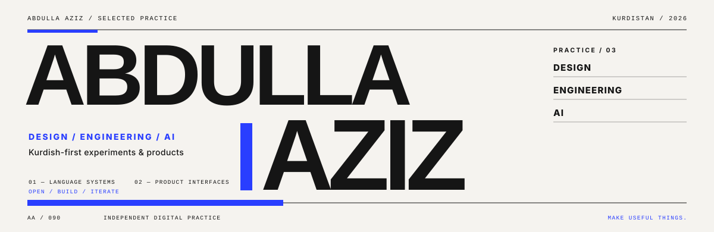
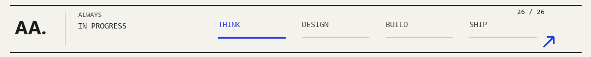
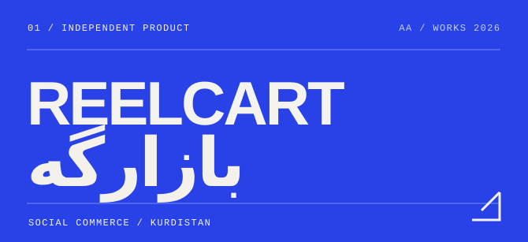
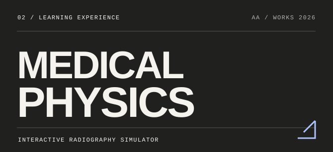
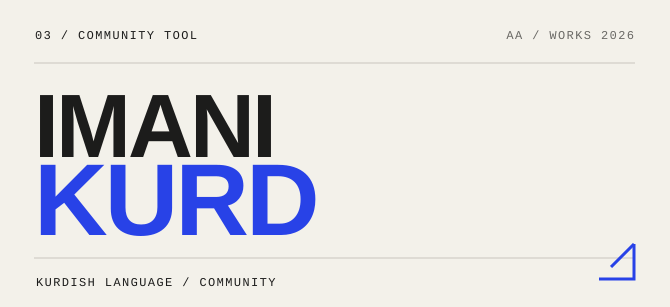
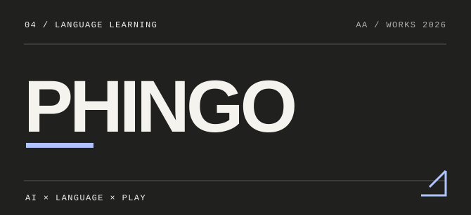
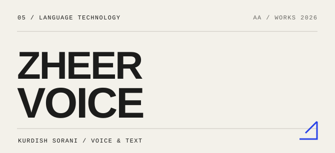
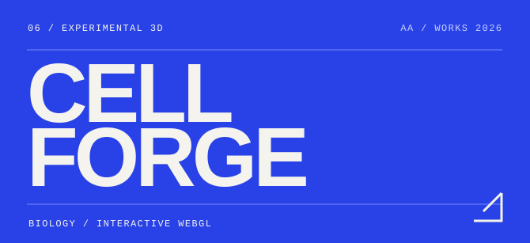
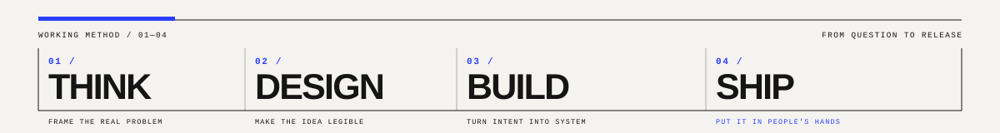

<!--
  Abdulla Aziz / an independent digital practice.
  GitHub-compatible native interactions: 
, anchors and clickable artwork.
  Regenerate the original editorial project tiles and GIF: py scripts/build_gallery.py
-->

  
   
   
  <a href="#selected-work"><strong>SELECTED WORK ↗</strong></a> &nbsp;&nbsp;/&nbsp;&nbsp;
  <a href="#about"><strong>ABOUT</strong></a> &nbsp;&nbsp;/&nbsp;&nbsp;
  <a href="#explore-by-interest"><strong>EXPLORE</strong></a> &nbsp;&nbsp;/&nbsp;&nbsp;
  <a href="#contact"><strong>CONTACT</strong></a>

 

<table>
  <tr>
    <td width="66%" valign="top">
      ABOUT — 001
      <h2 id="about">Ideas deserve better interfaces.</h2>
      
I'm <strong>Abdulla Aziz</strong>, a creative developer building at the intersection of <strong>design, engineering and AI.</strong> I make useful products for Kurdish speakers, expressive web experiences and interactive 3D worlds.

      
I care about the parts people actually feel: clear thinking, small details, fluid interactions and software with a point of view.

    </td>
    <td width="34%" valign="top">
      PRACTICE — 002
      
<strong>01.</strong> Product design <strong>02.</strong> Creative development <strong>03.</strong> Language technology <strong>04.</strong> Interactive 3D

      BASED IN KURDISTAN / BUILDING FOR EVERYWHERE
    </td>
  </tr>
</table>

 

## Selected work

001—008 / AN INDEPENDENT PROJECT INDEX &nbsp;&nbsp; · &nbsp;&nbsp; THE ARTWORK IS CLICKABLE

<table>
  <tr>
    <td width="50%" valign="top">
      
       <b>01 / Reelcart · بازارگە</b>
       Kurdish-first social commerce: from social media traffic to orders, storefronts and sales.
        <a href="https://github.com/Abdulla090/bazarga"><strong>Source ↗</strong></a> &nbsp;/&nbsp; <a href="https://bazarga.vercel.app"><strong>Live project ↗</strong></a>
    </td>
    <td width="50%" valign="top">
      
       <b>02 / Medical Physics</b>
       An interactive clinical training environment: patient journeys, radiography practice and simulated X-rays.
        <a href="https://github.com/Abdulla090/medicalphysics"><strong>Explore source ↗</strong></a>
    </td>
  </tr>
  <tr>
    <td valign="top">
      
       <b>03 / Imani Kurd · ئیمانی کورد</b>
       A Kurdish digital home for Quran, education and everyday spiritual tools.
        <a href="https://github.com/Abdulla090/imanikurd"><strong>Source ↗</strong></a> &nbsp;/&nbsp; <a href="https://imanikurd.vercel.app"><strong>Live project ↗</strong></a>
    </td>
    <td valign="top">
      
       <b>04 / Phingo</b>
       A playful way to learn English, with AI conversation practice and gamified lessons.
        <a href="https://github.com/Abdulla090/kurdlingoo"><strong>Source ↗</strong></a> &nbsp;/&nbsp; <a href="https://phingo.vercel.app"><strong>Try Phingo ↗</strong></a>
    </td>
  </tr>
  <tr>
    <td valign="top">
      
       <b>05 / Zheer Saz Voice</b>
       Experimenting with Kurdish Sorani speech, translation, OCR and everyday language AI.
        <a href="https://github.com/Abdulla090/zheer-voice"><strong>Source ↗</strong></a> &nbsp;/&nbsp; <a href="https://zheer-voice.vercel.app"><strong>Live project ↗</strong></a>
    </td>
    <td valign="top">
      
       <b>06 / 3DCellForge</b>
       An interactive cell exploration studio with organelle views, 3D interaction and GLB export.
        <a href="https://github.com/Abdulla090/3DCellForge"><strong>Explore source ↗</strong></a>
    </td>
  </tr>
</table>

<b>07 / <a href="https://github.com/Abdulla090/aiacademic">AI Academic ↗</a></b> — AI-assisted studying, citations, flashcards, mind maps and quizzes. <a href="https://aiacademic.vercel.app">Live project ↗</a>

<b>08 / <a href="https://github.com/Abdulla090/BMX_Racer">DESCENT / BMX Racer ↗</a></b> — A cel-shaded downhill BMX game with procedural terrain, graphics and sound. <a href="https://bmx-racer.vercel.app">Play ↗</a>

<a href="https://github.com/Abdulla090?tab=repositories"><strong>ALL REPOSITORIES &nbsp; ↗</strong></a>

 

## Explore by interest

THE INDEX IS INTERACTIVE. OPEN A SECTION TO SEE MORE OF THE WORK.

  
<strong>01 &nbsp; / &nbsp; Language, culture & community &nbsp; ↗</strong>

   

  I care about what happens when software starts from the language of the person using it.

  **[Phingo](https://github.com/Abdulla090/kurdlingoo)** — language learning for Kurdish speakers. 
  **[Zheer Voice](https://github.com/Abdulla090/zheer-voice)** — Sorani voice and text technology. 
  **[Imani Kurd](https://github.com/Abdulla090/imanikurd)** — a Kurdish-first community experience. 
  **[Reelcart](https://github.com/Abdulla090/bazarga)** — commerce built around local sellers.

  
<strong>02 &nbsp; / &nbsp; Interactive worlds & simulation &nbsp; ↗</strong>

   

  Work that invites you to move, explore, experiment and play.

  **[Medical Physics](https://github.com/Abdulla090/medicalphysics)** — walk through a radiography workflow. 
  **[3DCellForge](https://github.com/Abdulla090/3DCellForge)** — explore and export biological 3D models. 
  **[DESCENT](https://github.com/Abdulla090/BMX_Racer)** — downhill BMX in a generated 3D world. 
  **[TinySkies](https://github.com/Abdulla090/tinyskies)** — multiplayer flight around customizable globes.

  
<strong>03 &nbsp; / &nbsp; Practical AI & learning tools &nbsp; ↗</strong>

   

  I like AI most when it removes friction from a real task.

  **[AI Academic](https://github.com/Abdulla090/aiacademic)** — study and productivity tools. 
  **[Phingo](https://github.com/Abdulla090/kurdlingoo)** — interactive AI language practice. 
  **[Zheer Voice](https://github.com/Abdulla090/zheer-voice)** — language utilities designed for Kurdish Sorani.

  
<strong>04 &nbsp; / &nbsp; The working philosophy &nbsp; ↗</strong>

   

  **01 — Question.** Find something worth solving. 
  **02 — Form.** Give the idea a visual voice. 
  **03 — Build.** Make it tangible, fast and responsive. 
  **04 — Refine.** Sweat the awkward details. 
  **05 — Ship.** Give it to real people and learn.

 

## Working tools

LANGUAGES, SYSTEMS AND MEDIUMS USED ACROSS THE PROJECTS

**TypeScript** &nbsp;·&nbsp; **React** &nbsp;·&nbsp; **React Native** &nbsp;·&nbsp; **Three.js** &nbsp;·&nbsp; **Python** &nbsp;·&nbsp; **Blender** &nbsp;·&nbsp; **Vite** &nbsp;·&nbsp; **AI APIs**

 

## Contact

<table>
  <tr>
    <td width="50%"><a href="https://github.com/Abdulla090"><strong>GITHUB</strong> &nbsp; / &nbsp; More code ↗</a></td>
    <td width="50%"><a href="https://twitter.com/Abdullla_ai"><strong>X / TWITTER</strong> &nbsp; / &nbsp; Say hello ↗</a></td>
  </tr>
</table>

INDEPENDENT DIGITAL PRACTICE &nbsp; / &nbsp; ABDULLA AZIZ &nbsp; / &nbsp; © 2026

